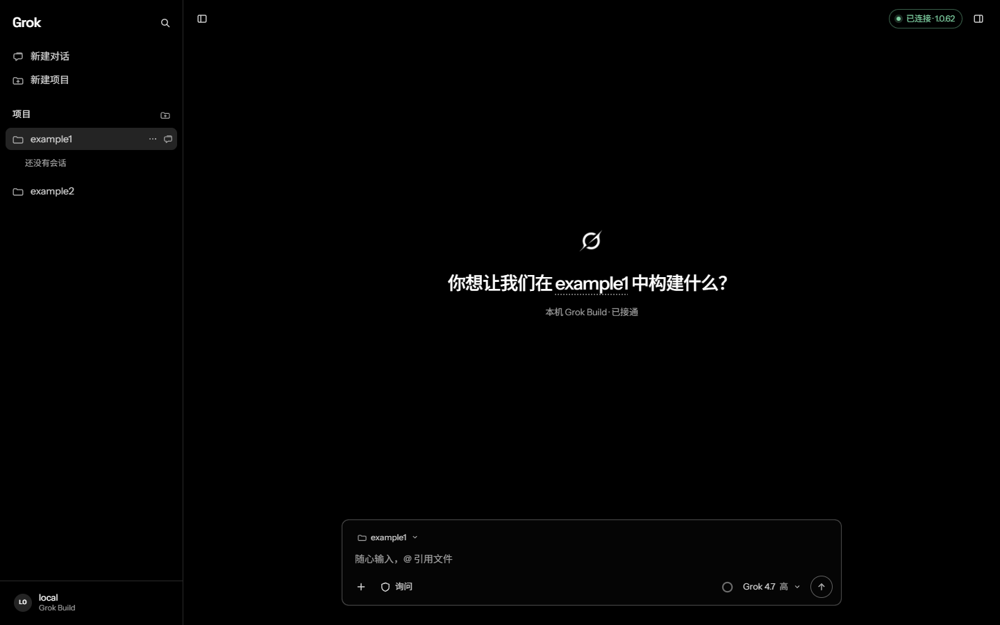
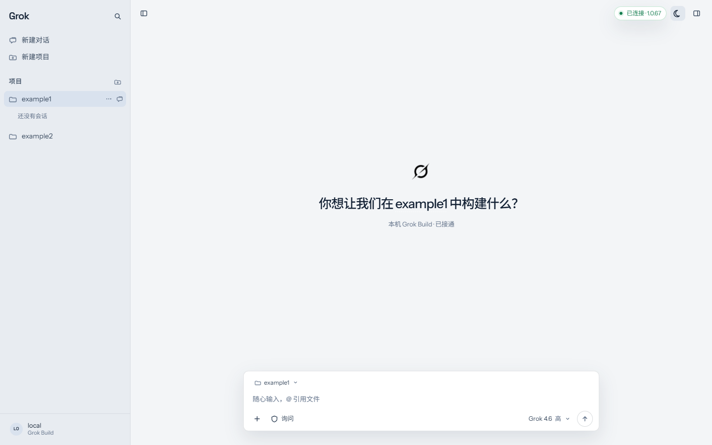
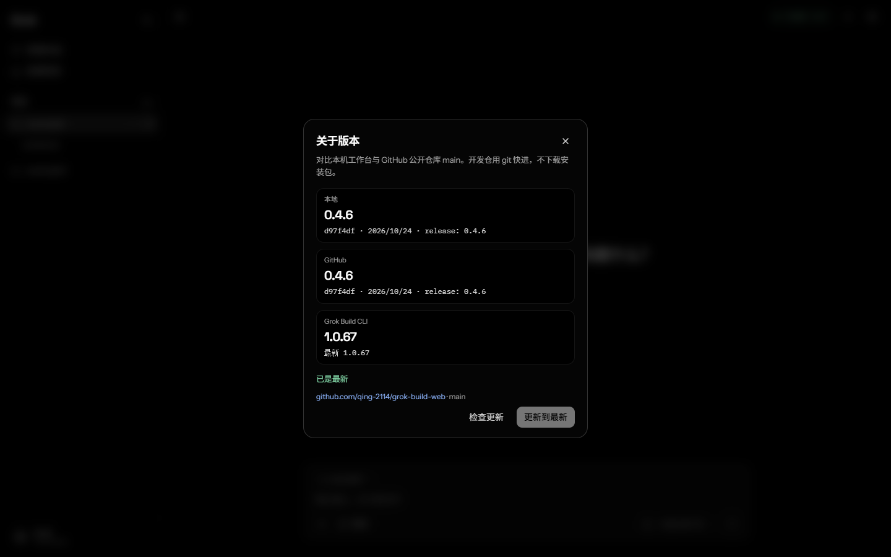
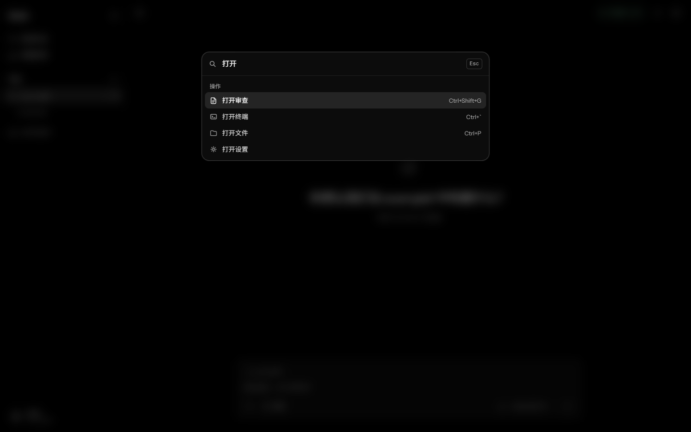
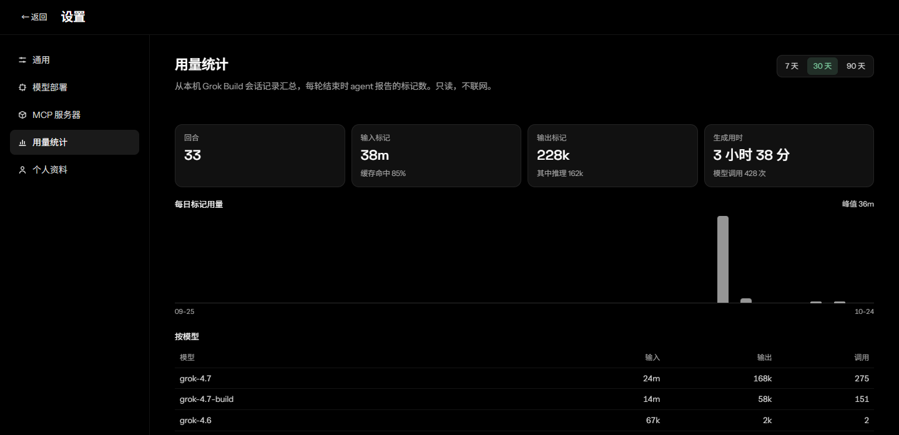
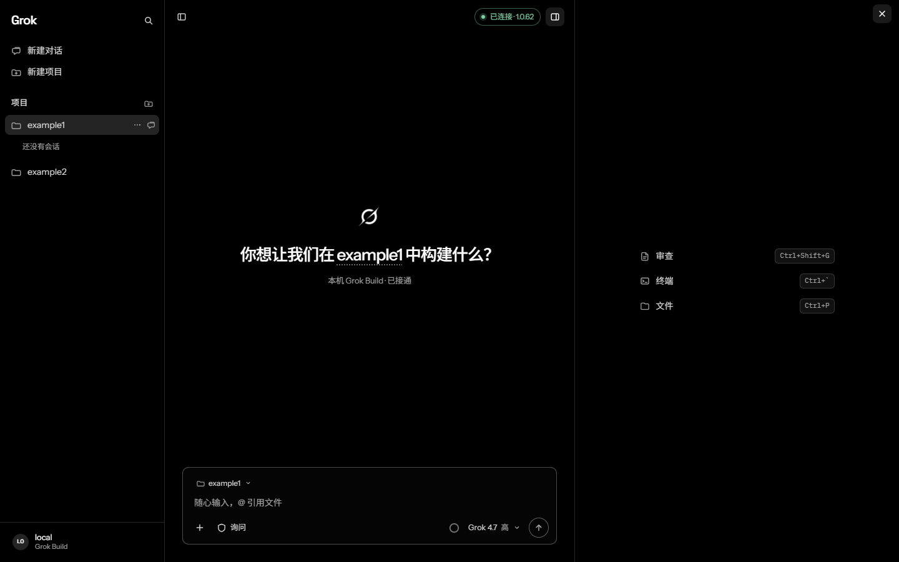
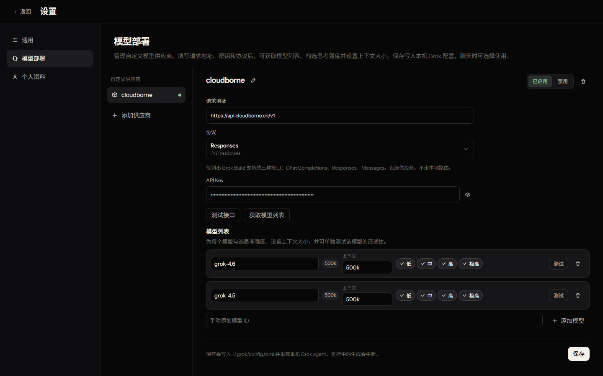
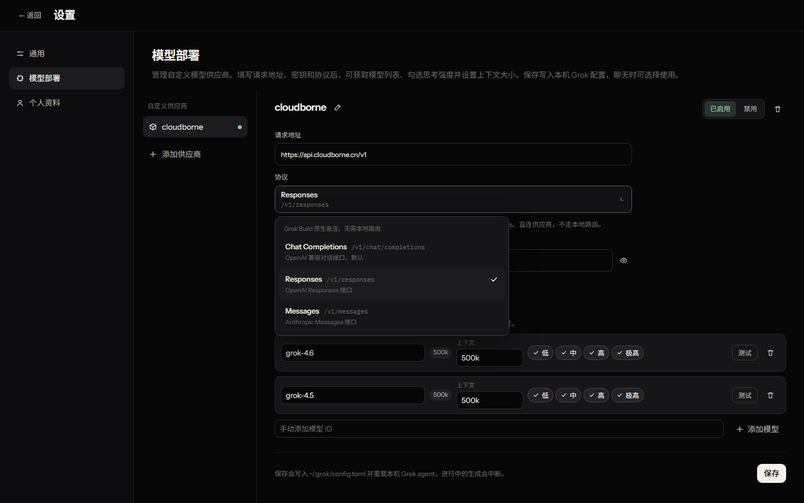

## 为什么做它

Grok Build 已经能在本机通过 CLI / TUI 工作，但长时间使用命令行时，项目切换、会话回看、文件预览和模型设置仍然分散在不同入口。这个项目把这些动作收进一个只绑定本机回环地址的工作台，界面负责操作，Grok agent 仍然在本机运行。

## 当前形态（v0.4.6）

左侧管理项目与历史会话，中间用文档流呈现对话，底部是输入坞。工作台通过 ACP JSON-RPC 拉起 `grok agent --no-leader stdio`，把流式回复、工具调用和权限请求接回页面。未连接时界面会明确显示本机未连接，不把静态页面伪装成已经接通。

现在它有两种打开方式：Windows 安装包装好后是自带的 Electron 窗口，后台服务无终端窗口运行，关窗即停；开发仓仍可以 `npm run dev` 在浏览器里用。

v0.4.6 加了深浅色切换，顶栏一个按钮来回切，偏好存在本机。

## 最近进展

### v0.4.x：装得上、能自己更新

- **Windows 安装包**：发布 `Grok-Build-Setup-<版本>.exe`，不用再克隆仓库、装 Node、自己构建。
- **关于页更新**：安装版对比 GitHub 最新 Release，下载安装包静默覆盖；开发仓对比 `main` 的 git SHA，工作区干净且落后时才允许一键快进。拉不到 GitHub 时不显示「已是最新」。
- **Grok Build CLI 一键安装 / 更新**：探测不到 `grok` 时跑官方安装脚本；已安装就用 `grok update --check --json` 检查新版本。
- **字体自托管**：去掉 Google Fonts，中文用 Noto Sans SC 可变字重，正文、标签、标题、强调四档固定为 400 / 500 / 600 / 700。
- **细节修复**：跨平台文件夹选择（桌面窗口走系统对话框）、Word 版式预览、文件类型图标、任务栏图标缓存、流式会话空闲超时续期、已发送附件回显、编辑后重发、按所选模型发送、浅色主题下的文字选区。

### v0.3.0：从「能聊」到「能干活」

- **真正的集成终端**：node-pty + xterm.js，vim、交互式提示、进度条都能用；焦点在终端时全局快捷键让给 shell。
- **Ctrl+K 命令面板**：操作、会话、项目、文件放在一个入口，会话导出 Markdown 也在这里。
- **工具调用详情**：每条工具卡片可单独展开参数、输出和逐行 diff，详情按需从服务端读取，不塞进会话状态。
- **审查面板**：对 git 更改暂存、取消暂存、撤销（三秒内二次确认）、写说明提交。
- **MCP 服务器与用量统计**：MCP 只通过 `grok mcp` 子命令读写，不自己拼 TOML；用量统计只读本机会话记录，按天、按模型汇总，不猜费用。
- **输入坞**：`@` 引用项目文件、计划清单、每轮用量、完成提醒系统通知。

### v0.2.x：先把边界守住

- 服务只监听 `127.0.0.1`，`/api/*` 做同源和主机校验。
- 修掉外开链接的命令注入，以及发送与等候队列的状态机问题；macOS / Linux 支持合并回主线。
- 启动脚本改成无窗口后台运行，另配停止脚本。

## 右侧栏与模型部署

右侧栏可以打开审查、集成终端和文件预览，都是可关闭、可新增的标签。文件支持代码高亮、Markdown、PDF、图片和 DOCX 正文预览；对话里的本地路径可以直接点开，网页链接用 Ctrl+单击交给系统浏览器。

设置页可以登记自定义供应商、读取模型列表、配置思考强度和上下文大小，并单独测试模型推理。配置写入本机 `~/.grok/config.toml`，API Key 不进入仓库。工作台不修改 Grok Build 安装目录。

## 代码边界

纯状态在 `src/workspace-state.ts`，用 `node --test` 直接测 reducer；`src/workspace.tsx` 负责副作用，组件按字段订阅，流式输出时不整页重渲染。服务端桥接位于 `server/`。会话正文继续由本机 Grok 管理，浏览器只保存工作台偏好和项目资料。

本文截图用工作台的 `?demo=1` 模式拍摄，不读取本机真实会话。

项目源码与安装说明：[qing-2114/grok-build-web](https://github.com/qing-2114/grok-build-web)
